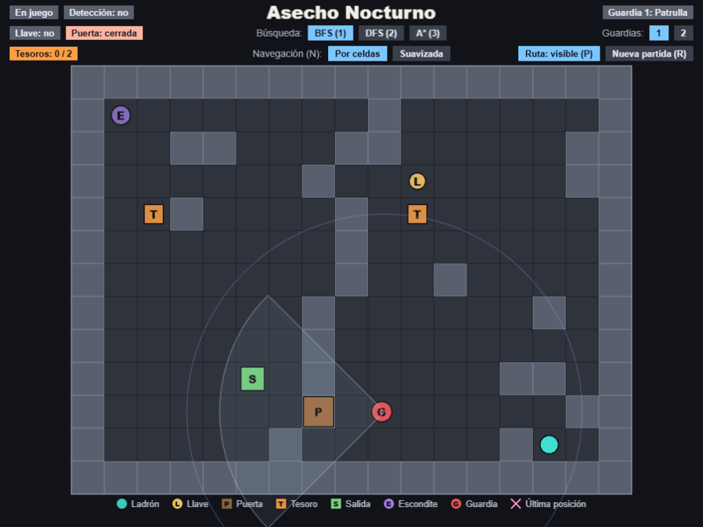

# Asecho Nocturno

Prototipo de sigilo en grilla para una sola pantalla, hecho como TP Final Integrador de PIAPC (individual, Facundo Castillo).

Un ladrón entra a una casa, consigue la llave, abre la puerta, toma al menos un tesoro y escapa por la salida evitando a uno o dos guardias. El jugador no mueve al ladrón con el teclado: hace clic en una celda alcanzable y el ladrón recorre el camino calculado por el algoritmo elegido. El foco del proyecto es la IA: búsquedas, navegación, percepción, FSM del guardia y escenarios variables.



## Jugar en el navegador

**Enlace al juego:** `ENLACE_PENDIENTE_VERCEL`

El juego se juega desde el navegador, sin instalar nada. Hace falta un navegador moderno.

_Marcador: reemplazar `ENLACE_PENDIENTE_VERCEL` por la URL del despliegue en Vercel una vez creado._

## Requisitos

Para ejecutar el proyecto en local:

- [Node.js](https://nodejs.org) con `npm`.
- Un navegador moderno.

## Instalación y ejecución

```bash
npm install
npm run dev-nolog
```

Luego abrir `http://localhost:8080` (si el puerto está ocupado, Vite usa otro y lo muestra en la consola).

## Scripts

| Comando | Descripción |
|---|---|
| `npm install` | Instala las dependencias. |
| `npm run dev` | Servidor de desarrollo con recarga automática. Envía una petición anónima (ver "Nota sobre log.js"). |
| `npm run dev-nolog` | Igual que `dev`, sin la petición anónima. |
| `npm run build` | Build de producción en `dist/`. Envía la petición anónima. |
| `npm run build-nolog` | Igual que `build`, sin la petición anónima. |

## Despliegue en Vercel

El juego es un sitio estático: Vite genera `dist/` y Vercel lo publica. Configuración del proyecto en Vercel (importando el repositorio de GitHub):

| Campo | Valor |
|---|---|
| Framework Preset | Other (o Vite) |
| Install Command | `npm install` |
| Build Command | `npm run build-nolog` |
| Output Directory | `dist` |

Se recomienda `build-nolog` para no ejecutar `log.js` en cada despliegue (ver "Nota sobre log.js"). Con `npm run build` también funciona, pero envía la petición anónima.

Cada push a la rama conectada genera un nuevo despliegue. El enlace público es el que aparece arriba en "Jugar en el navegador".

## Controles

| Acción | Control |
|---|---|
| Mover al ladrón | Clic en una celda alcanzable. Un clic nuevo durante el movimiento recalcula la ruta desde la celda actual. |
| Elegir búsqueda | `1` BFS, `2` DFS, `3` A* (también los botones de la franja superior). |
| Alternar navegación | `N`: Por celdas / Suavizada (también el selector). |
| Mostrar u ocultar la ruta | `P` (también el botón). |
| Nueva partida | `R` (también el botón). |
| Cantidad de guardias | Botones `1` y `2`. Cambiarla inicia una nueva partida. |

La búsqueda, la navegación, la cantidad de guardias y la visibilidad de la ruta se conservan entre partidas.

Colores principales: el ladrón es turquesa, la llave amarilla, la última posición conocida rosa, el cono de visión gris azulado (rojo cuando un guardia ve al ladrón). La leyenda inferior muestra cada elemento.

Victoria: tener al menos un tesoro y llegar a la salida. Derrota: un guardia alcanza al ladrón.

## Estructura del proyecto

| Ruta | Contenido |
|---|---|
| `index.html` | Página que contiene el juego. |
| `public/style.css` | Estilos globales de la página. |
| `src/main.ts` | Arranque de la aplicación. |
| `src/game/main.ts` | Configuración de Phaser (1024 × 768, escalado). |
| `src/game/scenes/Game.ts` | Escena principal: dibujo, HUD, entrada del jugador, guardias y reglas de victoria y derrota. |
| `src/game/grid.ts` | Constantes de la grilla y mapa activo. |
| `src/game/scenario.ts` | Generación y validación de escenarios. |
| `src/game/pathfinding.ts` | BFS, DFS y A*. `findGuardPath` trata la puerta cerrada como transitable. |
| `src/game/navigation.ts` | Waypoints por celdas y suavizado (string-pulling). |
| `src/game/perception.ts` | Percepción del guardia: visión en cono, oído y última posición conocida. Lógica pura. |
| `src/game/guard.ts` | FSM del guardia (`PATRULLA`, `INVESTIGAR`, `PERSEGUIR`). Lógica pura. |
| `vite/` | Configuración de Vite para desarrollo y producción. |
| `log.js` | Petición anónima del template (ver más abajo). |

## Documentación

- [`GDD.MD`](GDD.MD): diseño del juego (fuente de verdad del diseño).
- [`Specs.MD`](Specs.MD): specs ordenadas, con criterios de verificación.
- [`PRESENTACION.md`](PRESENTACION.md): guion de la presentación del prototipo.

## Estado de las specs

| Spec | Estado |
|---|---|
| 01 Grilla y escena | Terminada |
| 02 Búsquedas y movimiento | Terminada |
| 03 Navegación | Terminada |
| 04 Escenarios variables | Terminada |
| 05 Interacción y victoria | Terminada |
| 06 Percepción | Terminada |
| 07 FSM del guardia y derrota | Terminada |
| 08 UI final y pulido | Terminada |
| 09 README y presentación | Implementada, pendiente de aprobación |

## Limitaciones conocidas

- Sin arte, audio, animaciones ni sprites externos: todo es geometría y texto.
- Sin puntaje, semillas, guardado, progresión ni menú de inicio.
- El sonido no se propaga realísticamente: el oído es un radio de 6 celdas sin bloqueo por paredes.
- La FSM del ladrón descrita en el GDD (`REPOSO`, `MOVIENDO`, `OCULTO`, `ATRAPADO`) no está implementada; el ladrón se controla solo por clics.
- Un guardia más lento que el ladrón (4 y 5 celdas/s) puede no alcanzar a un ladrón en movimiento.
- Sin versión móvil ni controles táctiles.
- Las ideas recortadas están en la sección "Posibles mejoras/cambios" del GDD.

## Nota sobre log.js

`npm run dev` y `npm run build` ejecutan `log.js`, que hace una única petición anónima a `gryzor.co` (dominio de Phaser Studio, heredado del template). Solo envía el nombre del proyecto, si el build es `dev` o `build` y la versión de Phaser. Para no enviarla, usar `npm run dev-nolog` y `npm run build-nolog`.

## Licencia

MIT, ver [`LICENSE`](LICENSE). El texto de licencia es el del template de Phaser Studio.
